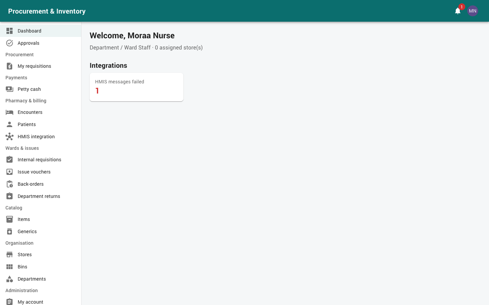
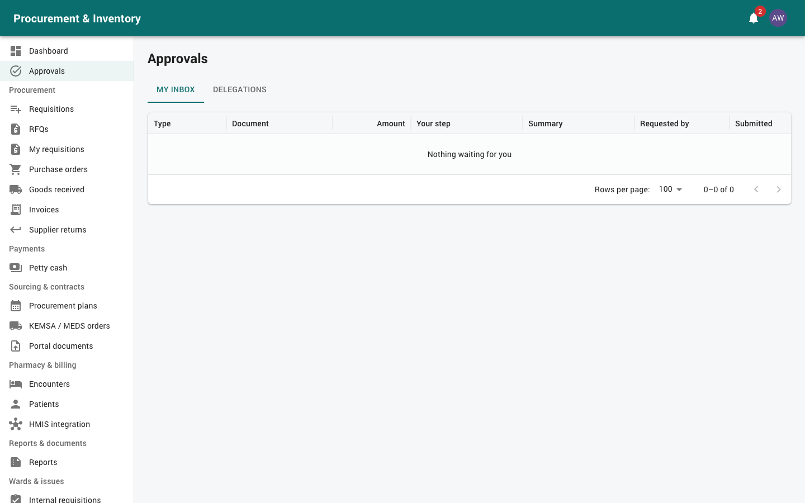

# Getting started (all users)

## 1. Signing in

1. Open the address your IT team gave you (for example `https://procure.yourhospital.org`).
2. Enter your **username** and **password** and press *Sign in*.
3. **First sign-in.** You must choose a new password before you can do anything else. The
   password policy (length, character types) is shown if your choice is refused.
4. **Two-factor sign-in (2FA).** If you turned it on, enter the 6-digit code from your
   authenticator app.

Things to know:

| Message | Meaning | What to do |
|---|---|---|
| *Invalid username or password* | Wrong username or password | Try again carefully; usernames are lower case |
| *Account temporarily locked. Try again later.* | 5 wrong passwords **or** 5 wrong 2FA codes | Wait 15 minutes, or ask the administrator |
| *Too many invalid codes; sign in again* | 5 wrong 2FA codes on one sign-in | Enter your password again, then a fresh code |
| *Too many requests* | Too many sign-in attempts from your network in a minute | Wait a minute |
| You are signed out while working | 30 minutes without activity, or 12 hours since sign-in | Sign in again; unsaved forms are lost |

## 2. Your account (*Administration → My account*)

* **Change password**: enter the current password and the new one twice.
* **Two-factor authentication**: *Set up two-factor authentication* shows a QR code.
  Scan it with an authenticator app (Google Authenticator, Microsoft Authenticator,
  Authy), then enter the code shown to confirm. *Turn off* needs your password and a
  current code. **Finance,
  procurement and administrator users should turn it on.**
* **Notification preferences**: for each category (Approvals, Requisitions, Payments,
  Petty cash, stock alerts…) choose *In app*, *Email* or both.

## 3. The screen

* **Left menu**, grouped by area (Procurement, Payments, Inventory…). You only see what
  your role allows. If you need a screen you can't see, ask the administrator to add the
  right role.
* **Dashboard** (home page) shows tiles for your work: approvals waiting, stock alerts,
  orders, invoices to pay, petty cash. Click a tile to open the list behind it.
* **Bell** (top right) shows notifications. It refreshes every 30 seconds.
* **Keyboard shortcuts**: `/` jumps to the search box of the page, `Alt+N` opens the
  *New* dialog, `Enter` submits a dialog and `Esc` closes it.
* **Document chain**: every document page (requisition, order, GRN, invoice, voucher…)
  shows the documents linked to it, before and after. Click any to open it.
* **PDF**: most documents have a *PDF* button. It prints them with their approval
  signatures.
* **Attachments**: drag files (PDF, JPEG, PNG) onto a document. Uploading a file with
  the same name adds a new version; old versions stay available.

## 4. Approving documents

Every document that needs approval (requisitions, orders, invoices, payment vouchers,
petty cash, stock adjustments, disposals…) goes through the same approval engine.

### In the app (*Approvals → My inbox*)

1. Open **Approvals**. *My inbox* lists everything waiting for you. Each row shows the
   document, amount, requester, the step and how long it has waited.
2. Open a document to check it. The chain, attachments and history are on the page.
3. Choose:
   * *Approve*;
   * *Reject* (a comment is required; the document stops);
   * *Return for amendment* (a comment is required; it goes back to the requester to
     change and resubmit).

### From an email

Approval emails carry a personal link. It opens a page showing the document summary
with *Approve*, *Reject* and *Return for amendment*, without signing in.

* The link works **once**, only for you and only for that step.
* It expires after **72 hours**. After that, use the app.
* If someone else has already acted on the step, the page says the approval *has moved on*.

### Rules you will meet

* You can never approve something you requested or prepared.
* Each approval in a cycle must be by a different person.
* If you don't act in time, you may get a reminder, and the step may be **escalated**
  to another role, whose members can then act on it too.

### Delegation (*Approvals → Delegations*)

Going on leave? Create a delegation: *Delegate to* a colleague, from and to dates, and a
reason. During that time they can approve **on your behalf**; the history records
"on behalf of". End it early from the same tab.

## 5. Statuses you will see

| Status | Meaning |
|---|---|
| Draft | Being prepared; only the author sees and edits it |
| Pending approval / Submitted | In the approval chain |
| Approved | All approval steps done |
| Returned | Sent back for changes; edit and resubmit |
| Rejected | Stopped by an approver |
| Cancelled | Withdrawn |
| Closed | Finished |

## 6. Getting help

* Something refused with a message in capitals (e.g. `OVER_LIMIT`,
  `ACCEPTANCE_REQUIRED`): the manual for your role explains the common ones.
* For access problems contact the **system administrator**. For approval limits and
  workflows, contact the **supply chain manager** or **finance manager**.
