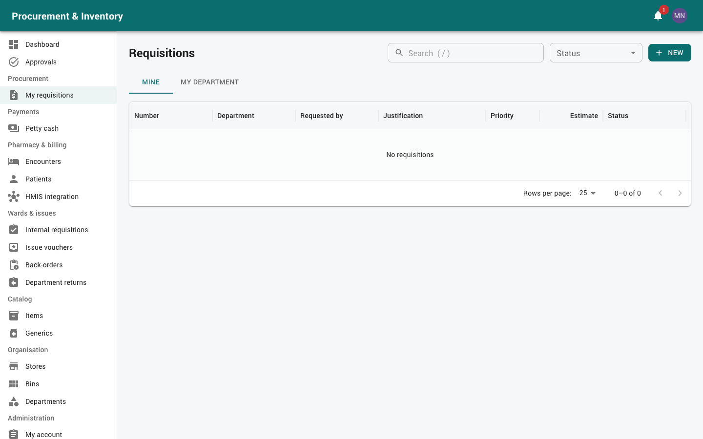
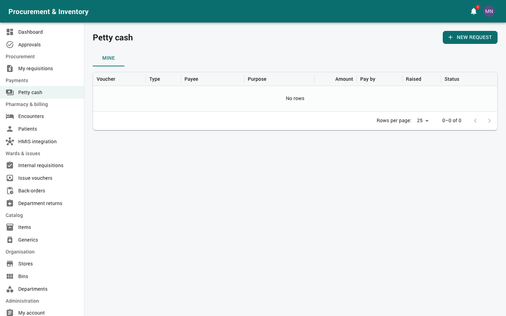

# Staff, requesters and heads of department

For every staff member who needs goods, services or cash, and for ward / department
in-charges (heads of department) who approve their staff's requests.

| You are | Built-in role | What you do here |
|---|---|---|
| Any staff member | any staff role (e.g. Department / Ward Staff) | Raise requisitions and petty cash requests, accept deliveries, collect goods |
| Ward / department in-charge (HOD) | Department / Ward In-charge | The same, plus approve your department's requests, sign off service deliveries and department plans |

Read [Getting started](00-getting-started.md) first.

---

## 1. Which request do I use?

| You need | Use | Menu |
|---|---|---|
| Anything for your department: stock items, goods the hospital does not stock, a service or repair | **Staff requisition** | *Procurement → My requisitions* |
| Routine ward stock from the store or pharmacy (top-ups, consumables, drugs) | **Internal requisition** | *Wards & issues → Internal requisitions* |
| A small cash payment, or an advance you will account for | **Petty cash request** | *Payments → Petty cash* |
| Record ward stock used on an admitted patient (so it is charged) | **Charge ward consumables** | *Pharmacy & billing → Encounters* |

A staff requisition may mix stock items and non-stock items. Stock items are sent to
the store automatically; everything else goes to Procurement.

---

## 2. Staff requisitions (*Procurement → My requisitions*)

### Raising one

1. *My requisitions* → *New* (or `Alt+N`).
2. Fill in the header:
   * **Department / cost centre**: your own department, or another one if you raise it on
     their behalf;
   * **Project** (optional), **Priority**, **Required by**;
   * **Justification**: why it is needed. Approvers read this;
   * **Store for the stock items**: the store that should issue any stock lines;
   * **Budget** line (optional).
3. Add lines with *Add line*:
   * **Stock item**: pick the catalog item and quantity;
   * **Goods / service not in stock**: describe *What is needed*, the unit, quantity and
     **estimated cost**; add *Notes / specification*. Pick the **GL account** if you know
     it (your hospital may make it required).
4. Attach quotes, specifications or photos.
5. *Save draft* to finish later, or *Submit for approval*.

When you submit, the **budget** is checked. Depending on the budget's setting you either
see a warning, or the submission is refused until the budget is increased.

### Approval

| Amount | Approvers (default) |
|---|---|
| Up to 500,000 | Head of department (in-charge of the requesting department) |
| Above 500,000 | Head of department → Finance manager |

You are notified at each step. If it is **Returned**, open it, make the changes asked
for in the comment, and submit again.

### Following it

The requisition page shows **Where it is** for every line:

* **Stock lines** become an approved internal requisition at the store. Stock is
  reserved for you and the store issues it.
* **Other lines** go to the Procurement queue, then onto a purchase request, an order
  (LPO / LSO), delivery and hand-over to you.

Statuses: Draft → Submitted → Approved → Partly converted / Converted → **Closed**
(when everything is delivered). Also Returned, Rejected, Cancelled.

You get a notification when:
* the purchase request is approved;
* the order (LPO / LSO) is sent to the supplier;
* a delivery is **waiting for your acceptance**;
* goods have been received from the supplier;
* goods are **ready for collection** (with a one-time code if they hand over at the
  counter);
* the requisition is delivered and closed.

*Cancel requisition* (with a reason) withdraws it while nothing has been ordered.
*PDF* prints it with the approval signatures.

---

## 3. Accepting a delivered service or non-stock goods

When a supplier delivers a service (repair, maintenance, consultancy) or goods bought for
your requisition, the receiving officer records it. **You, or your department's in-charge,
must then accept it** before the supplier can be paid.

1. Open *My requisitions*. The **Waiting for you** panel lists deliveries to accept.
   (In-charges also see them under *Logistics → Service certificates*.)
2. Open the certificate. Check the quantities accepted and rejected, the notes and
   the attachments (job card, signed note, photos).
3. Choose *Accept delivery*, or *Reject* with a reason (the officer must correct it).

What acceptance does:
* the order counts as received, so the supplier's invoice can be matched and paid;
* a **service** accepted by you counts as delivered to you;
* **goods** still have to be handed over to you (next section).

Stock levels never change for non-stock items.

---

## 4. Collecting goods (hand-over)

When received goods are ready, Procurement or Stores hand them over to you or a
colleague in your department. You are told they are **ready for collection**.

You confirm receipt in one of two ways:

* **In the app**: open the hand-over (from the notification, or the *Waiting for you* panel
  on *My requisitions*) and click *I have received these*.
* **At the counter**: the officer clicks *Send code to the receiver* and you get a
  **6-digit code**. Tell it to the officer. The code is valid for 15 minutes; after 5 wrong
  attempts it stops working and a new one must be sent.

When every line is delivered, the requisition **closes** and you are told.

---

## 5. Internal (ward) requisitions (*Wards & issues → Internal requisitions*)

For routine stock from a store or pharmacy to your ward or department.

1. *New*: choose the **store** to supply you, priority and required-by date.
2. Add items and quantities (in base units, e.g. tablets, pieces). For an admitted
   patient, add the patient / encounter on the line, so the item is charged to them.
3. *Submit*. Your **ward in-charge** approves. Only the in-charge of *your* department
   can approve, never you.
4. On approval the stock is **reserved** for you. The store issues it oldest-expiry-first
   (FEFO) and prints an issue voucher.
5. If the store doesn't have everything, the rest stays on **back-order** and is issued
   when stock arrives.

Statuses: draft → pending approval → approved → partly issued (back-order) → issued, or
closed if a back-order is cancelled.

**Returning stock** (*Wards & issues → Department returns*): choose the issued lines,
quantity, reason and condition (resaleable or damaged / expired). The store posts the
return and your department is credited.

**Consumption** (*Wards & issues → Consumption*, in-charges): what your department used,
by period, item or patient, at cost.

---

## 6. Charging ward stock to a patient (*Pharmacy & billing → Encounters*)

Ward or theatre stock already issued to your ward and used on an admitted patient:
open the patient's **encounter** → *Charge ward consumables* → items and quantities. No
stock moves (it was issued to the ward already); the patient's bill is charged once.

---

## 7. Petty cash (*Payments → Petty cash*)

### Request a payment or an advance

1. *New*: choose the **float** (e.g. your department's or Administration).
2. Type:
   * **Payment**: to a staff member or a vendor;
   * **Advance / imprest**: cash to you, which you must account for later.
3. Fill in the **purpose**, **expense account**, **cost centre**, optional project and the
   **amount**. Attach receipts or quotes.
4. **Pay by**: cash, **M-PESA to a phone**, **PayBill + account** or **Till**. M-PESA is
   only possible on floats that pay by M-PESA, and in whole shillings.
5. *Submit for approval*.

Checks you may meet:

| Message | Meaning |
|---|---|
| `OVER_LIMIT` | Above the float's per-transaction limit; use a requisition instead |
| `INSUFFICIENT_FLOAT` | The float hasn't enough available cash now; try later or another float |
| `POSSIBLE_DUPLICATE` | Same payee and amount within 7 days. If it is genuinely different, fill in *Why this is not a duplicate*; approvers will see the warning |
| `ADVANCE_OUTSTANDING` | You have an advance not yet retired; retire it first |

### Approval (default)

| Amount | Approvers |
|---|---|
| Up to 10,000 | Your head of department → Finance |
| 10,000 – 50,000 | + Finance manager |
| Over 50,000 | + Medical director / CEO |

### Getting paid

Once fully approved, the **float custodian** pays you:
* **cash**: collect it, then confirm in the app with *I received it*;
* **M-PESA**: the money arrives on your phone; the request is marked paid when M-PESA confirms.

### Retiring an advance

Within **7 days** of receiving an advance:

1. Open the advance → *Retire the advance*.
2. *Add receipt* for each expense: amount, expense account, receipt reference, and attach
   the receipt image.
3. Submit. The custodian checks the receipts and either accepts them or returns them to
   you for correction.
   * Spent **less**: return the change to the custodian; it goes back into the float.
   * Spent **more**: the custodian pays you the difference.

You get daily reminders when a retirement is overdue, and you can't take a new advance
until it is retired.

---

## 8. For heads of department (in-charges)

### Approving

*Approvals → My inbox*. You see your department's:
* staff requisitions;
* internal requisitions;
* petty cash requests;
* purchase plans.

Check the justification, quantities, amounts and attachments, then *Approve*, *Reject* or
*Return for amendment*. See [Getting started → Approving](00-getting-started.md#4-approving-documents),
including approving by email and **delegating** while you're away.

You can't approve a request you raised yourself; it goes to another approver in the chain.

### Signing off deliveries

As in-charge you can accept or reject service and non-stock deliveries for your department
(section 3), even when the requester is away.

### Department plan (*Sourcing & contracts → Procurement plans*)

Prepare your department's annual procurement plan: items, quantities, quarter and budget
vote head. Submit it for approval (procurement → finance → management). Mid-year
revisions create a new version through approval; the approved version stays in force
meanwhile.

### Watching spend

*Reports* (if your role allows): consumption by department, pending requisitions,
delivered vs outstanding.
