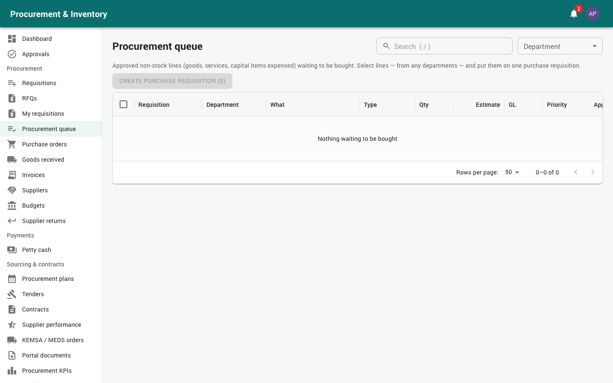
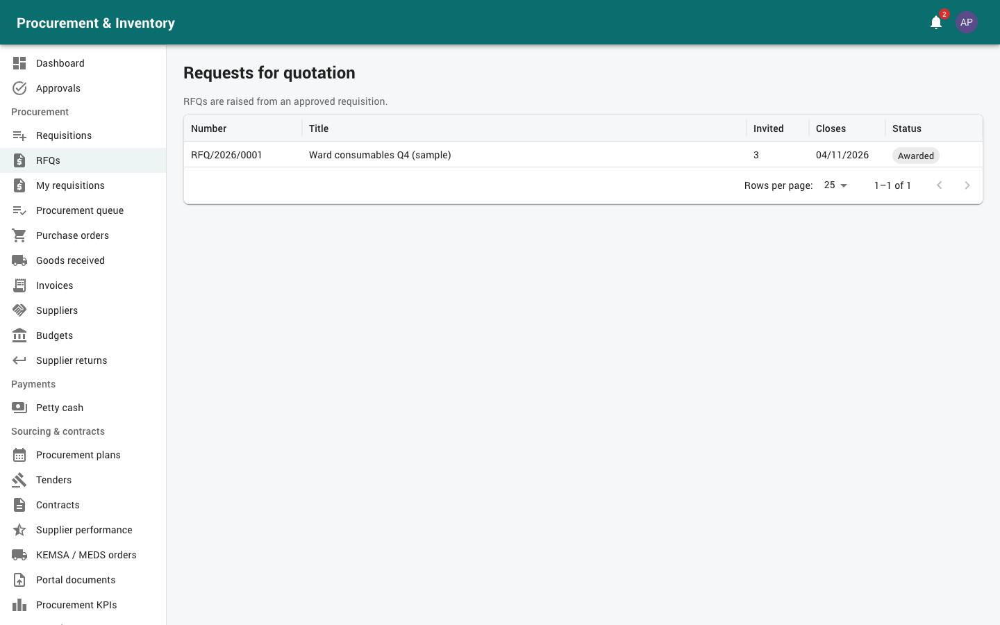
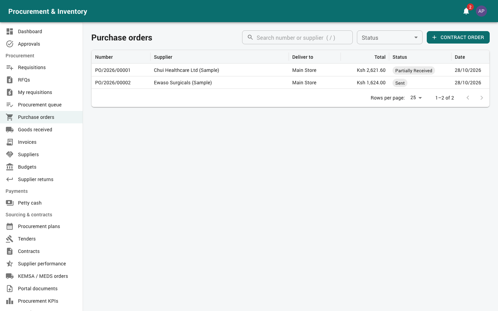

# Procurement officers and managers

For the **Procurement Officer** (buys: purchase requisitions, RFQs, orders, suppliers) and
the **Procurement Manager** (approves purchase requisitions and orders, manages tenders and
contracts). Read [Getting started](00-getting-started.md) first.

Your menu: *Procurement* (Requisitions, RFQs, My requisitions, Procurement queue, Purchase
orders, Goods received, Invoices, Suppliers, Budgets, Supplier returns), *Sourcing &
contracts* (plans, tenders, contracts, supplier performance, KEMSA / MEDS orders, KPIs),
*Logistics* (Inbound shipments, Service certificates), *Reports*.

---

## 1. The buying cycle

```
Staff requisition (REQ) ─┬─ stock lines ──► internal requisition at the store
                         └─ other lines ──► Procurement queue
                                              │
             Stock reorder suggestions ──► Purchase requisition (PR) ──► approval
                                              │
                         ┌────────────────────┴───────────────┐
                    RFQ ──► quotations ──► evaluation ──► award │ order directly
                         └────────────────────┬───────────────┘
                                   Purchase order / LPO / LSO ──► approval ──► send to supplier
                                              │
                 GRN (stock)  or  acceptance certificate (non-stock / services)
                                              │
                     Supplier invoice (Finance) ──► payment voucher ──► paid
                                              │
                          Hand-over of non-stock goods to the requester
```

Every document is linked; the **document chain** on each page shows the whole path.

---

## 2. Procurement queue → purchase requisition



*Procurement → Procurement queue* lists **approved non-stock lines** (goods, services,
capital items expensed) from every department's staff requisitions.

1. Tick lines, from one or several departments, that you will buy together.
2. *Create purchase requisition (n)*. Fill in:
   * **Owning department** and **Delivery location**;
   * **Procurement method** (Direct, RFQ, tender…). *Recommended by value* shows the method
     the value calls for; choosing another needs a *Method justification*;
   * **Suggested suppliers** and a justification.
3. The purchase requisition (PR) is created as a **draft**. Open it under *Procurement →
   Requisitions* and *Submit for approval*.

If the PR is rejected or cancelled, its lines go back to the queue.

**Stock items** reach you differently: from *Planning → Suggested reorder* or *Demand
forecasting* (selected suggestions become a draft PR), or a PR raised directly under
*Requisitions → New* (items in base units, justification, priority, required-by date,
budget).

### PR approval (default)

| Value | Approvers |
|---|---|
| < 100,000 | Procurement manager |
| 100,000 – 1,000,000 | Procurement manager → Supply chain manager |
| ≥ 1,000,000 | + Hospital management |
| Contains controlled-drug items | Pharmacist → Procurement manager |

The sourcing method is checked on submission against the value bands: low value
< 50,000; RFQ 50,000–1,000,000 with 3 bidders; open tender ≥ 1,000,000; restricted
tender, RFP and direct procurement need a justification.

PR statuses: Draft → Pending approval → Approved → **RFQ issued** → **Partially
fulfilled** → **LPO raised** / Closed. Cancelling or expiring an order gives its
quantities back to the PR.

---

## 3. Requests for quotation (*Procurement → RFQs*)



### Raising and sending

1. From an **approved PR**: *Request quotations* → title, closing date and *Invite
   suppliers*. Only **active** suppliers with valid prequalification can be invited.
2. *Send invitations*. Each supplier gets an email with the RFQ PDF; suppliers on the
   portal also see it there.
   * At least **3 suppliers** must be invited. With fewer, you must give a justification,
     otherwise it is refused (`MIN_SUPPLIERS`).

### Quotations

*Record a quotation* for each supplier (or the supplier submits it in the portal):
* unit price per line, in any currency with an exchange rate (blank = KES);
* delivery days, payment terms, compliant or not (*Why not compliant*).

The **Comparative analysis** converts every price to KES at today's rate, ranks the
compliant quotes and highlights the lowest. When the closing date has passed,
*Close bidding*.

### Evaluation (for quality-and-cost selection)

1. *Evaluation set-up* (before scoring): **technical weight** (0–100 %), **technical pass
   mark** (default 70) and the **evaluation committee**. A weight of 0 means price only;
   no evaluation is needed.
2. Each committee member opens the RFQ and enters *Your technical scores* (0–100 with a
   comment) for every compliant quotation.
3. When all scores are in: *Complete the evaluation*, with the committee recommendation.
   * Financial score = lowest compliant total ÷ this total × 100.
   * Combined = technical × weight + financial × (100 − weight).
   * A quotation below the pass mark cannot be recommended.

### Award

1. In the comparative sheet, the recommended (or lowest compliant) supplier is
   pre-selected for each line. Change a choice if needed.
2. Awarding a line to anyone other than the lowest compliant quote needs an **Award
   justification** (`JUSTIFICATION_REQUIRED`).
3. Set **Expected delivery** and, for non-stock, the **Delivery address / site**.
4. *Award and create orders*: one **draft order per supplier**, in the quotation's currency
   with the exchange rate fixed.

---

## 4. Purchase orders, LPOs and LSOs (*Procurement → Purchase orders*)



Orders are created from an RFQ award, from an approved PR (*Order directly (no RFQ)*), or
with *Order from contract price list*. An order with only non-stock lines is a **Local
Purchase Order (LPO)**. If every line is a service it is a **Local Service Order (LSO)**.

On the order:
* lines in an ordering unit (e.g. BOX of 100) converted to base units; VAT per line;
* non-stock lines: description, unit (JOB for services, PCS otherwise), GL account;
* **withholding tax** (default 5 % on services) on the pre-VAT amount, which you can override
  per line. The order shows the WHT and the **Net payable**;
* *Valid until*: order date + 60 days; *Terms*; *Deliver to*.

### Approval (default)

| Value (KES) | Approvers |
|---|---|
| < 500,000 | Procurement manager |
| 500,000 – 5,000,000 | Procurement manager → Finance |
| ≥ 5,000,000 | + Hospital management |

Approval **commits the budget**. A BLOCK budget refuses approval when exceeded.

### Sending

*Send to supplier* emails the order with its PDF (some hospitals send automatically on
approval). Suppliers on the portal see it and acknowledge it there.

### Changing an order

* *Amend* (with *Reason for the amendment*): creates a new **version** that needs
  re-approval on the new value. *Version history* keeps every version. A rejected
  amendment restores the previous version.
* *Cancel purchase order* (with reason): only if nothing has been received. The budget
  commitment is released and the quantities go back to the PR.
* *Close purchase order*: stop waiting for the rest; releases what is still committed.
* **Expiry**: approved or sent orders past *Valid until* with nothing received or invoiced
  expire overnight. The commitment is released, the quantities return to the PR, and you are
  notified.

Order statuses: Draft → Pending approval → Approved → Sent → Partially received →
Received → **Invoiced** → **Paid**; also Cancelled, Closed, Expired.

---

## 5. Receiving

* **Stock items** are received by Stores on a **GRN** (see [Stores](03-stores.md)).
* **Non-stock goods and services** are recorded on an **acceptance certificate**
  (*Logistics → Service certificates → Record delivery / completed work*). A storekeeper or
  certifying officer records accepted and rejected quantities. **You can't record it for an
  order you raised or approved.** When the order was bought for staff requisitions, the
  requester or their in-charge must *Accept delivery* before it can be posted
  (`ACCEPTANCE_REQUIRED`).
* **Inbound shipments** (*Logistics → Inbound shipments*): track shipped and expected dates,
  carrier and tracking for important orders. Delays are flagged daily.

## 6. Hand-over to the requester

On the staff requisition page, *Delivery to the requester* shows each non-stock line as
ordered / received / delivered / waiting.

1. *Hand over*: choose the receiver (the requester or an active colleague in their
   department), the quantities received and not yet handed over, the condition and notes.
2. The receiver confirms in the app (*I have received these*), or at your counter: *Send
   code to the receiver* and type the 6-digit code they give you (15 minutes, 5 attempts).
3. When everything is delivered the requisition closes automatically.

You can only hand over what has been received (`NOT_RECEIVED`).

---

## 7. Suppliers (*Procurement → Suppliers*)

* Register: name, **KRA PIN** (validated, e.g. `P051234567X`), contacts, categories
  supplied, **prequalification** status and expiry, payment details (the bank account is
  stored encrypted and shown masked).
* Attach licences and certificates with their expiry dates. *Reports & documents →
  Documents → Expiring supplier documents* lists those expiring soon.
* Status: active / suspended / blacklisted (with reason). Suspension, blacklisting and
  reinstatement go through approval (supply chain → management). Only **active, prequalified**
  suppliers can be invited or ordered from.
* **Performance** (*Sourcing & contracts → Supplier performance*): on-time delivery,
  quality rejects, price variance, and monthly scorecards. A score below 60 opens a
  corrective action.
* Suppliers with portal users quote, bid, acknowledge orders and submit invoices online
  (see [Supplier portal](11-supplier-portal.md)).

## 8. Budgets (*Procurement → Budgets*)

Per department × vote head × financial year. A PO approval **commits**; an approved
invoice turns the commitment into **actual**; cancelling or closing **releases** it. Each
budget is WARN (warning shown) or BLOCK (refused when exceeded). Report: *Budget vs
committed vs actual vs paid*.

## 9. Tenders, contracts and plans (Procurement manager)

* **Annual procurement plans** (*Sourcing & contracts → Procurement plans*): departments
  prepare them; you **consolidate** the approved plans into the hospital plan, by item and
  vote head.
* **Tenders**: notice → bid documents → clarifications and addenda → sealed bids (portal or
  bid register; no prices are visible before opening) → **opening** with attendees and
  minutes → **evaluation committee** (one chair; each member signs a conflict-of-interest
  declaration; preliminary, technical and financial evaluation) → recommendation →
  professional opinion → award approval (supply chain → management) → award and regret
  letters → contract. Scores are locked once the evaluation is locked.
* **Contracts and framework agreements**: prices, quantities, validity, performance
  securities and milestones. **Call-off orders** become draft POs at contract prices within
  the remaining balance. **Variations** apply after approval (procurement → finance).
  Alerts at 90 / 30 days before expiry.
* **KEMSA / MEDS orders**: order templates per store and cycle raise draft POs when due.

## 10. Approving (Procurement manager)

*Approvals → My inbox*: purchase requisitions and orders in your band. Check value,
supplier, budget line and justification (and, for awards, the comparative sheet and the
award justification). You can't approve a document you raised.

## 11. Reports you'll use

On *Reports*: Pending requisitions · Pending purchase requests · Open orders / LPOs ·
Outstanding POs · RFQ status and awards · GRN / acceptance registers · Received not
invoiced · Three-way match exceptions · Purchases over time · Supplier performance · Price
history · Procurement cycle time · Budget vs actual · Delivered to users vs outstanding ·
Procurement KPIs. Each one can be exported (CSV / Excel / PDF) or *emailed on a schedule*.

## 12. Common messages

| Message | Meaning |
|---|---|
| `MIN_SUPPLIERS` | Fewer than 3 suppliers invited without a justification |
| `JUSTIFICATION_REQUIRED` | Award past the lowest compliant quote without a justification |
| Complete the technical evaluation before awarding | The RFQ has a technical weight and isn't evaluated yet |
| Supplier not eligible | Supplier suspended, blacklisted or prequalification expired |
| Budget exceeded | BLOCK budget: ask Finance to raise it, or reduce the order |
| `ACCEPTANCE_REQUIRED` | The requester must accept the delivery first |
| `NOT_RECEIVED` | Hand-over of more than has been received |
| `NON_STOCK_LINE` | A GRN can't receive non-stock lines; use an acceptance certificate |
