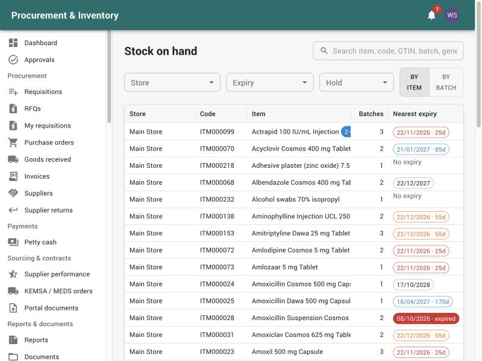
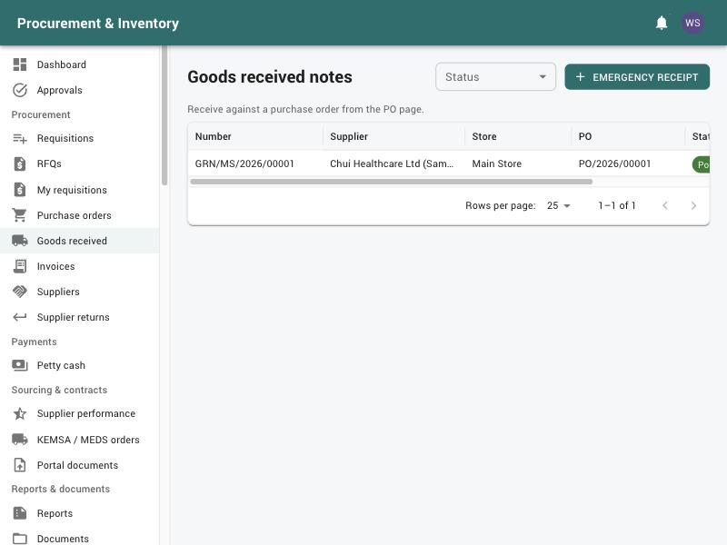

# Stores (storekeepers)

For storekeepers of the main store and satellite stores. Pharmacists who run a pharmacy
store use the same screens for receiving, transfers, adjustments and stock takes. Read
[Getting started](00-getting-started.md) first.

Your menu: *Inventory* (Stock on hand, Receipts, Transfers, Adjustments, Stock takes),
*Wards & issues* (Internal requisitions, Issue vouchers, Back-orders, Department returns),
*Procurement* (Goods received, Supplier returns), *Planning* (Suggested reorder, Near
expiry, Stock levels, Stock alerts), *Logistics* (Distribution, Service certificates,
Labels).

You only see and move stock in **the stores assigned to you**.

---

## 1. How stock works (the rules the system enforces)

* All stock is kept in **base units** (tablet, piece, ml). Packs are converted.
* Every movement is written to the **stock ledger** and cannot be edited or deleted. A
  mistake is corrected by a new movement (adjustment or return).
* Stock leaves by **FEFO** (first expiry, first out). Picking another batch needs the
  *override FEFO* permission and a reason, which is recorded.
* The system refuses:
  * negative stock;
  * issuing **expired** batches, batches **on hold** (quarantine, recall, expired) or stock
    in the quarantine bin;
  * receiving goods that are already expired;
  * any movement dated on or before the store's **period lock** date;
  * movements of items frozen by a **stock take** in progress;
  * **controlled drugs** without a second signatory (witness username and password) who
    holds the controlled-drug permission;
  * cold-chain or controlled items moved by someone without the matching permission.
* **Available** = on hand − reserved. Stock reserved for approved requisitions can't be
  issued to others, transferred or returned to a supplier.

---

## 2. Stock on hand (*Inventory → Stock on hand*)

* Filter by store, bin, item, generic, category, batch; *Group by* item or batch; show
  *Expired* or held stock; search by name or code.
* **Bin card**: open an item to see every movement with a running balance, where it
  came from or went to, the patient and the witness.
* **Batch trace**: every movement of a batch, where it is now and which patients got it.

---

## 3. Receiving from suppliers: GRN (*Procurement → Goods received*)

1. Open the **purchase order** (*Procurement → Purchase orders*; only approved / sent
   orders with something outstanding) → *Receive goods*. If the order arrived on a notified
   shipment, pick the shipment. Enter the **Delivery note** number.
2. For each line, enter the quantity received in the **delivery unit** (converted to base
   units), the **batch**, manufacture and **expiry** dates (required for batch-tracked
   items) and the **bin**. You can *Scan barcode* to find the line. For cold-chain items,
   enter the *Arrival temperature*: outside 2–8 °C puts the batch on hold.
3. Attach the delivery note and certificates of analysis.
4. *Send for inspection*.
5. **Inspection committee**: at least **2 people**, and not the receiver, open the GRN,
   *Record results* (accepted and rejected quantities with reasons) and *Confirm as committee
   member*.
6. *Post accepted goods to stock*.

What posting does:
* accepted quantities enter stock at the order cost (VAT included);
* rejected quantities create a **return to supplier** automatically;
* the order's received quantities are updated;
* back-orders waiting for these items are re-reserved.

Rules:
* more than ordered (beyond the tolerance, default 0 %) is refused;
* the receiver can't be the person who requested the PR or approved the order;
* **Non-stock lines** (services, items not kept in stock) can't be received on a GRN
  (`NON_STOCK_LINE`); see section 4.

**Emergency receipt** (*Goods received → Emergency receipt*; no order yet,
`purchasing.emergency_receipt`): receive without a PO,
with *Why there is no PO*. It stays flagged until you *Regularise with PO*.

---

## 4. Receiving non-stock goods and services (*Logistics → Service certificates*)

For repairs, services and goods not held in stock:

1. *Record delivery / completed work* → choose the order.
2. For each line: **accepted** quantity, and any **rejected** quantity with its reason.
   Partial deliveries are fine.
3. Add inspection notes and the signed job card, delivery note or photos.
4. If the order was for a staff requisition, the **requester or their in-charge** must
   *Accept delivery* before you can post (`ACCEPTANCE_REQUIRED`). Otherwise post it yourself.

You can't record a delivery for an order you raised or approved. **Stock levels never
change** for these lines.

Then **hand the goods over** to the requester. On the requisition: *Hand over* → the
receiver confirms in the app or with the **6-digit code** they get
(*Send code to the receiver*). See [Procurement → Hand-over](02-procurement.md#6-hand-over-to-the-requester).

---

## 5. Issuing to wards and departments

### Internal requisitions (*Wards & issues → Internal requisitions*)

Wards raise them; their in-charge approves; on approval the stock is **reserved** for them.
You see approved requisitions for your store waiting to be issued (also on the dashboard).

### Issue voucher

1. Open the requisition → *Issue*. The **issue plan** proposes FEFO picks (batch, bin,
   expiry) for everything outstanding.
2. Confirm each pick, ideally by scanning the item barcode or batch number (*Scan item
   barcode or batch number*). A code that doesn't match is refused. Your hospital may make
   scanning compulsory.
3. To pick a different batch, enter the *FEFO override reason* (needs the permission).
4. Controlled drugs: a **witness** enters their username and password.
5. Enter who collected it and post. Print the **issue voucher PDF** (batch, expiry, bin,
   value, signatures).

Whatever can't be supplied stays on **back-order** (*Wards & issues → Back-orders*). When
stock arrives it is reserved automatically, most urgent and oldest first, and you are told
which back-orders can now be filled. A back-order can be cancelled with a reason.

### Department returns (*Wards & issues → Department returns*)

Post a ward's return: lines from what was issued to them, reason and condition.
* **Resaleable** goes back to the same batch in a usable bin.
* **Damaged / expired** goes to the **QUARANTINE** bin; stock there is never issued.

A department can't return more than it was issued. It is credited at the cost it was charged.

---

## 6. Transfers between stores (*Inventory → Transfers*)

1. The **receiving** store requests: *Request stock from another store* → *Request from*
   (store), items, quantities (base units) → *Send*.
2. The **supplying** store opens it → *Dispatch*. Picks are FEFO; overriding needs a reason.
   The stock is now **in transit**.
3. The receiving store → *Confirm receipt*, quantities received, *Put away to bin*. A
   shortfall needs a *Discrepancy reason* and is written off from transit.

Planned routes from the main store to satellites (picking lists, packing, dispatch note,
proof of delivery per stop) are under *Logistics → Distribution*.

---

## 7. Adjustments (*Inventory → Adjustments*)

For breakage, losses, found stock, expiry write-offs.

1. *New stock adjustment* → store, **reason** (each reason is an increase or a decrease),
   items, batch (or *New / found batch*), quantity, notes and attachments.
2. *Submit for approval*. An approver who is not you approves it; large adjustments need a
   **second, different approver**.
3. It posts on final approval. A rejected adjustment shows the *Rejection reason*.

Expiry write-offs get a **disposal certificate** PDF once posted.

---

## 8. Stock takes (*Inventory → Stock takes*)

1. *New stock take*: a *Full count* (the whole store is frozen) or a *Cycle count (selected
   items)*. Counts can be **blind** (system quantities hidden).
2. *Freeze and start counting*: a snapshot is taken and movements of those items are
   blocked.
3. Print the *Count sheet*, count, enter the counted quantities and *Save counts* (as many
   times as needed).
4. *Submit for review*. The **Variance** and value per line are shown.
5. Someone other than you reviews it → *Approve and post variances*. Stock is corrected and
   the items are unfrozen.

Plan counts out of hours. Nothing can be issued or received for frozen items.

---

## 9. Returns to suppliers (*Procurement → Supplier returns*)

* **From stock**: supplier, store, reason and batch lines (the GRN and order are found from
  the batch) → *Dispatch*. Expired, held and quarantined stock may be returned; reserved
  stock may not.
* **Inspection rejects** from a GRN are created automatically.
* Record the supplier's **credit note** (number, date, amount) when it arrives; any
  difference is shown.

---

## 10. Planning and alerts (*Planning*)

* **Stock levels**: per item per store, min / max / reorder level / reorder quantity /
  safety stock / lead time. **AUTO** levels are recalculated nightly from average monthly
  consumption (AMC); editing a level switches the row to **MANUAL**.
* **Suggested reorder**: items at or below their reorder level, with suggested quantities.
  Select, adjust, and press one button:
  * the **main store** (one that buys) gets a draft purchase requisition, sent to Procurement;
  * a **satellite store** gets a transfer request to its parent store.
* **Near expiry**: batches expiring within 30 / 60 / 90 / 180 days, their value, whether they
  will be used up in time, and the store using the most of them. Actions: **redistribute**
  (transfer), **return to supplier**, **write off** (adjustment with reason EXPIRY). Expired
  batches are put on hold automatically every night.
* **Stock alerts**: reorder, stock-out and near-expiry alerts for your stores (also in the bell
  and by email, one message per store and type).

---

## 11. Labels (*Logistics → Labels*)

Shelf labels (barcode + bin) and batch labels (GS1 DataMatrix with GTIN, expiry and batch
where the item has a GTIN). Print from the item, bin or GRN.

---

## 12. Common messages

| Message | Meaning / what to do |
|---|---|
| Insufficient stock / would go negative | Less available than asked; check reservations and holds |
| Batch expired / on hold | Pick another batch; held stock is handled by Quality |
| Period locked | The date is on or before the store's closed period; use today's date or ask Finance |
| Item frozen by a stock take | Finish or cancel the count first |
| Second signatory required | Controlled drug: a witness with the controlled-drug permission signs |
| Over-receipt | More than ordered; receive only what was ordered, or ask Procurement to amend the PO |
| `NON_STOCK_LINE` | Use *Logistics → Service certificates* |
| `ACCEPTANCE_REQUIRED` | The requester / in-charge must accept the delivery first |
