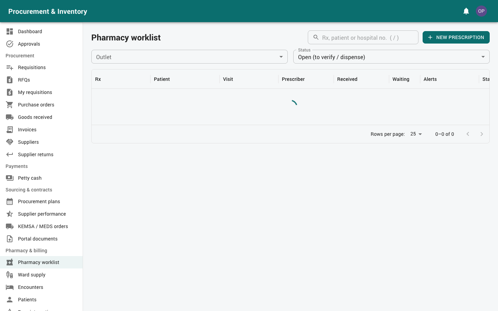

# Pharmacy (pharmacists and pharmacy technicians)

For pharmacists and pharmacy technicians in the main pharmacy and the outpatient,
inpatient, theatre and emergency outlets. Read [Getting started](00-getting-started.md)
first. For stock work in your pharmacy (receiving, transfers, adjustments, stock takes,
issues to wards), see [Stores](03-stores.md). The rules are the same.

| | Pharmacist | Pharmacy technician |
|---|---|---|
| Receive / enter prescriptions, dispense | ✔ | ✔ |
| **Verify** prescriptions, **override** clinical alerts | ✔ | – |
| Approve P / POM sales at the till, approve stock adjustments and stock takes | ✔ | – |
| Manage the interaction list, catalog, recalls and quality holds | ✔ | – |
| Controlled and cold-chain items | ✔ | ✔ |

Your menu: *Pharmacy & billing* (Pharmacy worklist, Ward supply, Encounters, Patients, Drug
interactions, Sales & receipts), plus the *Inventory*, *Wards & issues* and *Planning*
screens for your outlets, and *Point of sale* if you sell at the counter.

---

## 1. Patients (*Pharmacy & billing → Patients*)

The hospital's HMIS is the patient register. This system keeps a copy of what dispensing
needs: hospital number, name, date of birth, sex, weight, pregnancy, payer / scheme and
**allergies**.

* *Find in HMIS*: search by hospital number or name and import the patient (refreshed
  automatically when the copy is old).
* *New patient*: only when the HMIS is not connected.
* Keep **allergies**, **weight** and **pregnancy** up to date: the clinical checks use them.

---

## 2. The worklist (*Pharmacy & billing → Pharmacy worklist*)

Choose your **outlet**. The worklist shows open prescriptions, oldest first, with waiting
time and alert badges. It refreshes every 30 seconds.

Prescriptions arrive:
* **from the HMIS** automatically, as doctors order them (mapped drug codes; orders with
  an unmapped code wait on the HMIS dashboard for the administrator);
* **entered here**: *New prescription* → patient, encounter / visit, prescriber; *Add
  medicine* at **generic** level with dose, frequency, duration, route and quantity.

---

## 3. Clinical checks

Checks run when a prescription arrives, at verification and at every dispense, against the
other lines **and the patient's active medications** (dispensed in the last 30 days):

* drug–drug **interactions** (including each component of combination products);
* **allergies** by substance or class ("penicillins" matches a penicillin antibiotic);
* **duplicate therapy** (same substance: moderate; same class: minor);
* **minimum age** and **pregnancy** warnings.

| Severity | What happens |
|---|---|
| Contraindicated, major | **Blocking**: verification and dispensing stop until a pharmacist overrides the alert |
| Moderate, minor | Shown in colour; you can continue |

**Overriding** (pharmacists only): *Override clinical alert* → *Clinical reason (logged and
reported)*. Overrides can't be edited or deleted. They are listed under *Drug interactions
→ Alerts raised vs overridden*. *Re-run checks* after correcting the prescription or the
patient's details.

The starter interaction list is marked **DEMO**: it is an illustration, not a clinical
reference. Your hospital should import a licensed list (*Drug interactions → Import
interactions (CSV)*).

---

## 4. Verify and dispense

1. Open the prescription. Check the clinical checks panel.
2. *Verify* (pharmacist).
3. *Dispense*:
   * choose the **brand** (any brand of the prescribed generic; a substitution is recorded);
   * the **batch** is chosen FEFO; another batch needs the FEFO override and a reason;
   * **partial supply** is allowed. The balance stays open;
   * controlled drugs: a **witness** signs with their username and password.
4. Billing:
   * **billed here** (local billing): the dispense is invoiced. Take payment (cash, M-Pesa,
     card, insurance / scheme) and print the receipt;
   * **billed in the HMIS**: each item given is charged to the patient's HMIS bill
     automatically (*Charged to the HMIS bill*); no payment is taken here.
5. The dispense record (batch, expiry, brand) is sent back to the HMIS, so it shows on the
   patient's record.

Timestamps are kept: received → verified → first dispensed → completed. They feed the
turnaround reports.

*Cancel undispensed balance* (with a reason) closes what will not be supplied.

### Returns

*Return medicines*: choose the dispensed lines and quantities. Returned stock goes *Back
into sellable stock (same batch)*. A credit note is raised, or a negative charge on the
HMIS bill, and the HMIS record is updated.

---

## 5. Inpatients: ward supply (*Pharmacy & billing → Ward supply*)

Daily and unit-dose orders for admitted patients, by ward and bed. Each line shows what is
needed **today** (daily quantity − already given today). Select lines and dispense the round
(one dispense per prescription).

Ward stock top-ups are not done here; they are the ward's internal requisitions, issued
under *Wards & issues → Issue vouchers*.

---

## 6. Sales receipts and eTIMS

Every invoice and credit note is sent to **KRA eTIMS** through the outlet's control unit.
Until eTIMS accepts it, the receipt says **"eTIMS PENDING — THIS IS NOT AN OFFICIAL
RECEIPT"**. Once accepted you can reprint the signed receipt (marked COPY) from *Sales &
receipts*.

Items without an eTIMS mapping can't be invoiced. Tell the administrator or finance (*KRA
eTIMS* console).

Invoices can't be changed after issue; corrections are **credit notes**.

---

## 7. Stock in the pharmacy

* **Receiving**: GRNs with batch and expiry (and fridge temperature for cold-chain items).
  See [Stores, section 3](03-stores.md).
* **Transfers** from the main pharmacy to outlets, **adjustments**, **stock takes**: see
  Stores.
* **Near expiry, reorder, alerts** (*Planning*): see [Stores, section 10](03-stores.md).
* **Controlled drugs** sit in CD bins; every movement needs a witness.
* **Cold chain**: fridge readings and excursions are under *Quality & safety → Cold chain*.
  An excursion can quarantine the fridge's batches.

## 8. Quality and safety (pharmacists)

* **Complaints** (*Quality & safety → Complaints*): report a product quality problem or an
  adverse drug reaction (PPB report type, reference, date sent); print the report.
* **Recalls** (*Quality & safety → Recalls*): a recall quarantines every affected batch at
  once. The **trace** lists the stores holding them, wards issued and **patients dispensed
  (with phone numbers)**, so they can be contacted.
* **Holds**: batches under investigation can't be dispensed or sold until Quality releases
  them.

## 9. Selling at the counter

Over-the-counter sales are on the **Till**: see [Point of sale](05-point-of-sale.md).
Pharmacists also **approve P / POM sales** for cashiers (your username and password at
the till) and can **void and refund**.

## 10. Reports

*Reports → Pharmacy performance*: prescriptions and items dispensed (per pharmacist, outlet,
day), dispensing turnaround, revenue and margin, top-moving / slow-moving items, ABC and
VED analysis, fill rate and stock-outs, alerts overridden, expiry losses.

## 11. Common messages

| Message | Meaning |
|---|---|
| Blocking clinical alert | Contraindicated / major interaction, allergy or pregnancy flag; a pharmacist must override with a reason |
| Batch on hold / expired | Pick another batch; Quality manages holds |
| No stock | Nothing usable at this outlet; request a transfer from the main pharmacy |
| Item not mapped for eTIMS | The item can't be invoiced until finance / admin maps it |
| Witness required | Controlled drug: a second, different person with the CD permission signs |
