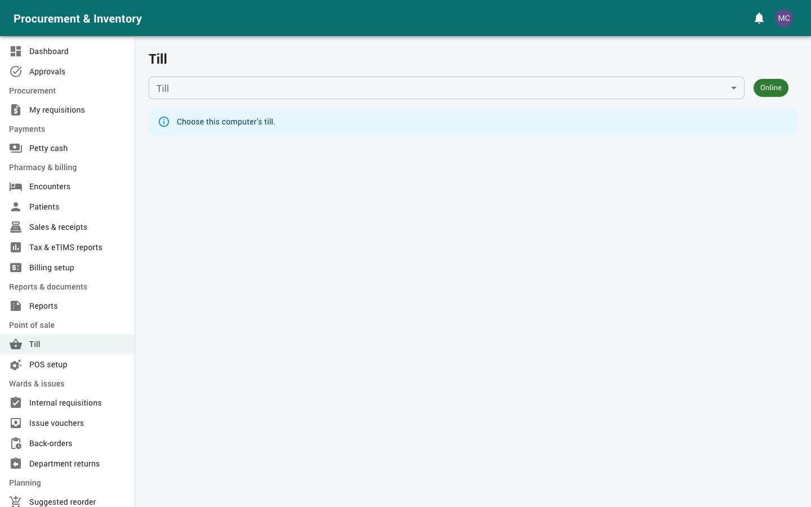

# Point of sale (cashiers and supervisors)

For cashiers selling over the counter at a pharmacy till, and for supervisors (pharmacists,
finance) who approve sales, overrides and cash-up variances. Read
[Getting started](00-getting-started.md) first.

Your menu: *Point of sale → Till* (cashiers); supervisors also have *Shifts & cash-up*,
*POS reports* and *POS setup*.

---

## 1. Open your shift

1. *Point of sale → Till*, choose your **till**.
2. *Open shift*: count the drawer and enter the *Opening float (cash in the drawer)*.

You can have only one open shift, and a till only one cashier at a time.

## 2. Selling

1. **Add items**: scan the barcode, or search by brand, generic or code. **Enter** adds the
   item; **F2** jumps to search; **F9** goes to payment. Quantities are in base units, so you
   can sell loose tablets from a pack. Stock left and *Low stock* are shown.
2. **Customer** (optional): pick a registered customer for their price list, credit
   account, loyalty points, or a KRA PIN on the invoice (business buyers).
3. **Discounts and promotions**: promotions apply automatically. You may give a manual
   discount up to your limit (cashier **5 %**, pharmacist 15 %); above it a supervisor with
   override rights enters their username and password.

### Items that need a pharmacist

| Sales class | Rule |
|---|---|
| OTC | Sell freely |
| P (pharmacy only) | A pharmacist approves: *Pharmacist approval*, their username and password |
| POM (prescription only) | Pharmacist approval **and** a *Prescription reference* |
| CD (controlled) | **Cannot be sold at the till** |

Some medicines have a **limit per sale** (e.g. paracetamol) across all brands.

### Safety check

The basket is checked for interactions (and against the customer's recent purchases,
allergies and pregnancy when they are a registered patient). A blocking interaction needs a
pharmacist and a *Reason to proceed despite the interaction*.

## 3. Taking payment

* **Cash**: enter *Cash tendered*; the change is shown.
* **M-Pesa**:
  * **STK push**: enter the *Customer phone* → *Send prompt*. The customer confirms on
    their phone and the payment is recorded automatically. If they don't answer in time,
    try again or choose another method;
  * **Paid to the till / paybill**: pick the customer's payment from the list of
    confirmations;
  * **Typed code**: enter the M-Pesa code from the customer's SMS. It is accepted but
    flagged until Safaricom confirms it (your hospital may require the match).
* **Card**: enter the slip number.
* **Split**: combine methods until the total is covered.
* **On account**: for customers with a credit limit.
* **Loyalty points**: 1 point per KES 100 paid; each point is worth KES 1 once the
  customer has at least 50.

Then *Print receipt* (80 mm) and *Next customer*.

**eTIMS.** Every sale is a tax invoice sent to KRA eTIMS. The receipt carries the
control-unit number and a QR code. If eTIMS hasn't answered within a few seconds, the receipt
says **"eTIMS PENDING — not an official receipt"**. The sale is sent as soon as possible and
the signed receipt can be reprinted later from *Sales & receipts*.

## 4. Voids and refunds

* **Void** (current shift only): open the sale → *Void* with a reason. Needs void rights or a
  supervisor.
* **Refund**: *Refund* the items and quantities, with a reason (refund rights or a
  pharmacist / supervisor).

Both create a **credit note** and put the stock back on its batch. Cash paid out comes off
**your** drawer. M-Pesa refunds are not automatic: refund in cash, or ask finance for a manual
M-Pesa payment.

Every void, refund, override and approval is logged.

## 5. Working offline

If the connection drops, the till **keeps selling** from its saved catalog:
* each sale is queued on the till and the receipt says eTIMS PENDING;
* **no controlled drugs**; P / POM only if you are a pharmacist; M-Pesa only by typed code
  (STK needs the connection).

When the connection returns, the queue is sent automatically and each sale becomes an
invoice **once**. A sale refused at sync (for example, no stock left, or too old) is listed
on the till; tell your supervisor. **Don't close the shift until the queue has been sent.**

## 6. Cash-up and closing

1. *X report* at any time: sales by payment method, voids, refunds, discounts, payments on
   account, M-Pesa codes not yet confirmed, and the **expected cash**.
2. At the end: *Cash up* → count the drawer by denomination.
3. Within **KES 50** of the expected cash, the shift closes and the **Z report** prints.
4. A bigger variance waits for a **supervisor**, who can *Accept the variance* or *Reject
   (follow up with the cashier)* under *Point of sale → Shifts & cash-up*. A cashier can never
   approve their own variance.

## 7. For supervisors

* **Shifts & cash-up**: open and closed shifts, expected vs counted cash, variances to
  decide.
* **POS reports**: sales by cashier, shift, item, category, payment method or hour, OTC
  margin, and the voids / refunds / overrides log (CSV).
* **POS setup** (manager): tills (store and default price list), customers and credit
  limits, promotions, and the M-Pesa connection (Daraja sandbox / production or mock, till
  or paybill, keys, callback address).

## 8. Common messages

| Message | What to do |
|---|---|
| Controlled drug cannot be sold | Refer the customer to the dispensing pharmacy with a prescription |
| Pharmacist approval required | Call the pharmacist to enter their credentials |
| Above your discount limit | A supervisor authorises |
| Limit per sale exceeded | Reduce the quantity |
| M-Pesa prompt timed out | Send again, or take another method |
| Variance outside tolerance | Recount; if it is right, the supervisor decides |
