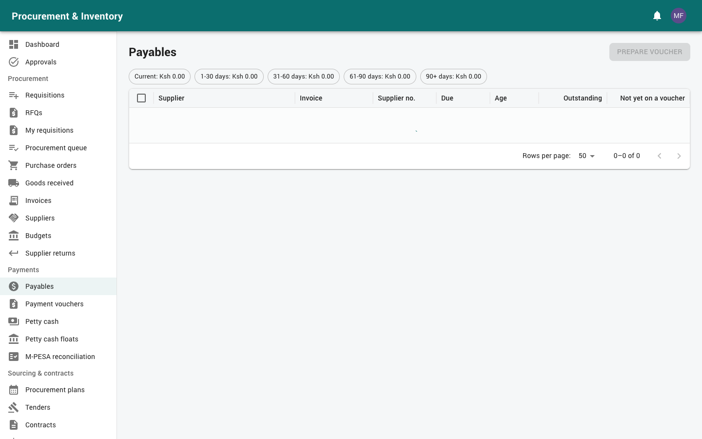
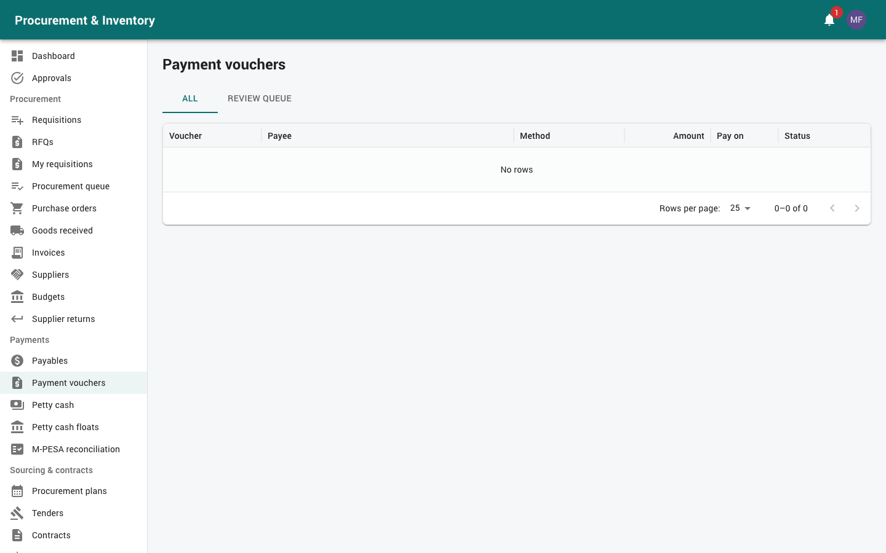
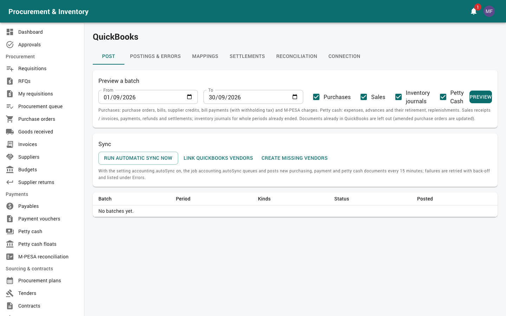

# Finance (finance officers, accountants and the finance manager)

For the **Finance / Accounts** role (supplier invoices, payment vouchers, releasing
payments, M-PESA reconciliation, QuickBooks, petty cash floats) and the **Finance manager**
(also approves orders, invoices, payments, petty cash and replenishments, and edits approval
workflows). Read [Getting started](00-getting-started.md) first. The float **custodian**'s
daily work is in [Petty cash custodian](07-petty-cash-custodian.md).

Your menu: *Procurement* (Purchase orders, Invoices, Budgets), *Payments* (Payables, Payment
vouchers, Petty cash, Petty cash floats, M-PESA reconciliation), *Pharmacy & billing*
(Accounts & currencies, QuickBooks, Sales & receipts, Tax & eTIMS reports, KRA eTIMS),
*Reports*.

**Segregation of duties** is enforced:
* whoever captures an invoice, prepares a voucher or raises a request can't approve it;
* the person who **releases** a payment can't be its preparer or one of its approvers;
* every blocked attempt is refused and written to the audit log.

So at least **two finance users** are needed (in the sample data, `finance` and `accountant`),
plus the finance manager.

---

## 1. Supplier invoices (*Procurement → Invoices*)

### Capturing

1. Open the **purchase order** → *Capture invoice*. Invoices are always captured against
   an order.
2. Enter the supplier's invoice number (unique per supplier), invoice date, due date, and
   for each line the quantity and price invoiced. Attach the invoice scan.
3. *Capture and match*. The **three-way match** compares each line with the order and with
   what was received (GRN, or the acceptance certificate for services):

| Flag | Meaning |
|---|---|
| Not received | Invoiced, but nothing received or accepted yet |
| Invoiced > received | More invoiced (including earlier invoices) than received |
| Invoiced > ordered | More invoiced than ordered |
| Price variance | Price differs from the order beyond the tolerance (2 %, plus an absolute limit if set) |
| NOT_ON_ETIMS | The supplier hasn't declared this sale on KRA eTIMS |

4. *Re-run match* after a late GRN or acceptance. *Submit for approval*.

Foreign-currency invoices use the order's currency at the invoice-date rate and keep a KES
**base total**. **Withholding tax** (from the order lines) is shown with the **net payable**;
it is deducted at payment.

### Approval

* Exceptions (any variance) go through the approval workflow (Finance).
* Your hospital may auto-approve invoices that match within tolerance.
* Approval books the **actual** against the budget and releases the commitment.

Statuses: Captured → Pending approval → Approved → Scheduled → Partially paid → **Paid**;
also Rejected, Returned, Cancelled. When an order is fully received and invoiced, it becomes
**Invoiced**; when its invoices are paid, **Paid**.

---

## 2. Paying suppliers

### Payables (*Payments → Payables*)

Approved invoices still owed: outstanding amount, amount not yet on a voucher, due date and
**ageing** (current, 1–30, 31–60, 61–90, 90+ days).

### Preparing a payment voucher (preparer)

1. Tick **one supplier's** invoices in **one currency** → *Prepare voucher*.
2. For each invoice: pay in full or in part. WHT is deducted in proportion. The voucher
   shows the amount settled, the **WHT** and the **cash paid to the supplier**.
3. *Pay by*:
   * bank transfer (EFT), cheque, cash;
   * **M-PESA PayBill** (business number + account number);
   * **M-PESA Till** (buy goods);
   * **M-PESA B2C** (phone number; entered as 07…, 2547… or +2547…).

   M-PESA pays KES in **whole shillings** only.
4. *Submit for approval*. The invoices become **Scheduled**. An invoice can't be put on more
   vouchers than it has left to pay.

### Approval (default)

| Amount | Approvers |
|---|---|
| Up to 1,000,000 | Finance manager |
| Above 1,000,000 | Finance manager → Hospital management |

### Releasing (releaser: a different finance user)

1. Open the **approved** voucher.
2. * **Bank / cheque / cash**: *Record payment* with the bank reference or cheque number.
   * **M-PESA**: *Send via M-PESA*.
3. The invoices' paid amounts update (Partially paid / Paid).

Release is **blocked** until every approval level is complete, and for the preparer and the
approvers. *Cancel voucher* is possible before release.

### What happens with M-PESA

| Result | Voucher |
|---|---|
| M-PESA confirms | **Paid**, with the M-PESA receipt, recipient name and charges |
| Refused (wrong number, no funds…) | **Failed**: nothing was sent. Fix the cause and *Send again via M-PESA* |
| No answer | **Processing**: the system asks M-PESA for the status every few minutes. If it was never processed it is sent again (up to 3 times) |
| Still unknown after 6 checks | **Review**: nothing more is sent until someone resolves it |

**A payment is never sent twice.** Double clicks and second releases are refused
(`ALREADY_DISPATCHED`).

### Review queue (*Payments → Payment vouchers → Review queue*, reconcilers)

Check the **M-PESA statement** first, then *Resolve*:
* **Paid**: enter the M-PESA receipt; or
* **Not paid**: frees the voucher for a fresh attempt.

**Never pay again before you have checked the statement.** Every resolution is audited.
*Check pending payments now* asks M-PESA about every payment still waiting.

**Reversal**: *Reverse on M-PESA* (with a reason). When M-PESA confirms, the voucher is
Reversed and the invoices are owed again.

The voucher **PDF** prints the invoices, WHT, net amount and approval signatures.

---

## 3. M-PESA reconciliation (*Payments → M-PESA reconciliation*)

1. Export the organisation **statement CSV** from the M-PESA portal (Receipt No., Completion
   Time, Details, Paid In, Withdrawn) → *Import* (upload or paste). Re-importing is safe.
2. *Reconcile* a day or a date range (the previous day is reconciled automatically at 06:00).

Exceptions to work through:

| Exception | Meaning |
|---|---|
| `NOT_ON_STATEMENT` | Paid here but not on the statement |
| `AMOUNT_MISMATCH` | Receipt found, different amount |
| `NOT_IN_SYSTEM` | A withdrawal on the statement this system didn't make |
| `STATUS_MISMATCH` | On the statement, but recorded here as failed or unknown: resolve it as paid |
| `PENDING` | No result yet |

Charges are totalled separately. Supplier payments and petty cash are both covered.

---

## 4. Petty cash (finance side)

* **Floats** (*Payments → Petty cash floats*, `pettycash.manage`): create a float per branch or
  department with its **custodian**, **float limit**, **per-transaction limit**,
  **replenishment threshold** (*Replenish below*), cash GL account and whether it *Pays by
  M-PESA*.
* **Approvals**: Finance checks coding and documents on every petty cash request; the Finance
  manager approves 10,000–50,000 and above, and **replenishments**.
* **Replenishment**: raised automatically when a float drops below its threshold (or by
  hand) for the amount up to the limit. After approval, the custodian records the cash
  received with its reference.
* The custodian's work (paying out, retirements, counts) is in
  [Petty cash custodian](07-petty-cash-custodian.md).

---

## 5. QuickBooks Online (*Pharmacy & billing → QuickBooks*)

### Set-up (*Connection*, *Mappings*)

* **Connection**: client ID / secret from the Intuit developer app, sandbox or production,
  *Connect to QuickBooks*. *Inventory journals from (go-live)*: nothing earlier is posted.
* **Mappings**: map every local key to a QuickBooks account, class or tax code:
  * **control accounts**: AP, AR, GRNI, VAT, stock in transit, adjustments, write-offs,
    opening balance equity, default bank, **M-PESA clearing**, **WHT payable**, **bank
    charges**, **staff advances**;
  * per **item category**: inventory, cost of sales, sales income, consumption;
  * per **payment mode / payment method**, per **tax category**;
  * **GL accounts**, and optional **store and department classes**.

  *Not mapped* counts show the gaps.
* **Vendors**: *Link QuickBooks vendors* matches existing vendors by KRA PIN or name;
  *Create missing vendors* creates the rest.

### What gets posted

| Here | In QuickBooks |
|---|---|
| Approved LPO / LSO | Purchase order (updated when amended) |
| Approved supplier invoice | Bill (stock lines to GRNI, non-stock lines to their GL account) |
| Paid voucher | Bill payment (+ vendor credit for WHT) |
| M-PESA charges | Purchase (bank charges) |
| Petty cash payment / advance / retirement / replenishment | Purchase / journal entries / transfer |
| Sales, credit notes, insurer settlements | Sales receipt, invoice + payment, refund / credit memo |
| Stock movements of a closed month | Inventory journal entry |

### Posting

1. *Post* → choose the period and kind → *Preview a batch*. Documents missing a mapping are
   **Blocked**, with what to map. Documents dated on or before the books' closing date are
   blocked as *Period closed*.
2. Post the **Ready** documents. They go in order (bills before their payments) and are
   **never posted twice**.
3. With automatic sync turned on, new purchases, payments and petty cash are posted every 15
   minutes (*Run automatic sync now* runs it at once).

**Errors** (*Postings & errors*): QuickBooks unavailable → **Pending**, retried
automatically. Rejected → **Failed**: fix the cause (usually a mapping), then *Rebuild and
send*.

Each purchase order, invoice, voucher and petty cash voucher shows a **QuickBooks chip**:
synced / pending / failed / not sent.

**Reconciliation**: compares, per account and period, the local documents, what was posted
and the QuickBooks movement. A difference means something was entered or changed directly in
QuickBooks. **Changes made in QuickBooks do not flow back here.**

**Settlements**: *Record a settlement* for insurer / corporate payments against their invoices.

---

## 6. Master data

* **Accounts & currencies** (*Pharmacy & billing → Accounts & currencies*): GL accounts (*New
  account*, or *Import from QuickBooks*), projects, currencies and **exchange rates** (*Save
  rate*). Foreign documents use the latest rate on or before their date. **Keep rates
  current**: RFQ comparisons, orders and invoices depend on them.
* **Budgets** (*Procurement → Budgets*): department × vote head × year, amount, and *When
  exceeded*: *Warn* or *Block approval*.

## 7. Finance manager

* **Approvals**: orders ≥ 500,000 (after procurement), invoice exceptions, payment vouchers,
  petty cash 10,000+, replenishments, staff requisitions above 500,000, plan and contract
  variations.
* **Workflows** (*Approvals → Workflows*): edit approval rules (document type, amount band,
  department, category, currency) and steps (role or named user, approvals needed, remind
  / escalate after N hours). Documents already in approval keep the old version.
* **Period locks** for stores and **stock adjustment** approvals.

## 8. Reports

*Reports → Payments*: AP ageing · Payments by method · Payment schedule / cash requirement ·
M-PESA log and reconciliation · Withholding tax and VAT summary. *Petty cash*: cash book,
pending, spend, outstanding advances, replenishments. *Procurement*: received not invoiced
(accruals), match exceptions, budget vs actual. *Audit*: QuickBooks sync status, payment
control exceptions (duplicate payments, split requests, payments with nothing received).
*Tax & eTIMS reports*: VAT output and input, credit notes, eTIMS reconciliation.

## 9. Common messages

| Message | Meaning |
|---|---|
| `USE_PAYMENT_VOUCHER` | Invoices are paid through a voucher, not directly |
| Release blocked: not fully approved | Wait for every approval level |
| Release blocked: preparer / approver | Another finance user must release |
| `ALREADY_DISPATCHED` | The M-PESA payment is already on its way; don't retry |
| Whole shillings only | M-PESA amounts can't have cents |
| Blocked: not mapped | Add the QuickBooks mapping, then preview again |
| Period closed | The document is dated in a period closed in QuickBooks |
