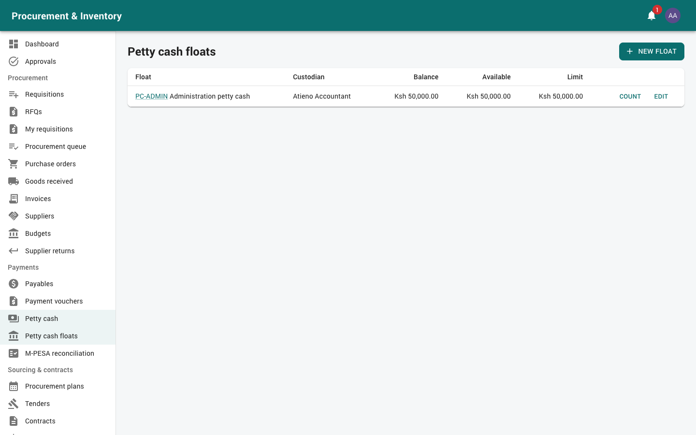

# Petty cash custodian

For the person who holds a petty cash float (in the sample data, the accountant holds
`PC-ADMIN`). You need the *disburse petty cash* permission (Finance / Accounts has it) and to
be named as the float's custodian. Read [Getting started](00-getting-started.md) first.

Your menu: *Payments → Petty cash* and *Petty cash floats*.

**Rules**:
* you never approve requests on your own float;
* you only pay requests that are **fully approved**;
* you never pay a request you raised or approved;
* you never check your own retirement.

Attempts that break these rules are refused and audited (`PETTY_CASH_RELEASE_BLOCKED`).

---

## 1. Your float (*Payments → Petty cash floats*)

The float page shows the **Balance** (cash in hand per the cash book), **Available** (balance
minus requests pending, approved or being paid), the limits, and *Low* when the float is
below its replenishment level. The balance changes **only** through the cash book:

| Movement | When |
|---|---|
| Opening | Float set up |
| Replenishment | Cash received from finance |
| Disbursement | You paid a request |
| Refund | Change returned from an advance |
| Top-up | You paid an advance's overspend |
| Reversal | A payment reversed |

## 2. Paying approved requests (*Payments → Petty cash*)

The custodian view lists requests on your float that are **approved and waiting for payment**.

**Cash**
1. Open the request; check the payee and amount.
2. *Pay out cash*; record *Collected by* (who took the cash).
3. The cash book is updated. The payee confirms in the app (*I received it*). The request
   shows *Receipt confirmed*.

**M-PESA** (floats that pay by M-PESA)
1. Open the request → *Send via M-PESA*. It goes through the same engine as supplier payments: it
   is **sent once only**, with status checks and retries.
2. The float moves only when M-PESA confirms (*M-PESA receipt* shown).
3. If the outcome is unknown, the request goes to **M-PESA review**. Check the M-PESA
   statement, then *Resolve* as **paid** (with the receipt) or **not paid**. Never pay
   again before checking.

The **petty cash voucher PDF** prints the approvals, who paid and who received.

## 3. Advances: checking retirements

Staff must retire an advance within **7 days** (daily reminders go to them and to you).

1. Open the advance → *Check the retirement*. Review each receipt: amount, expense account
   and the attached receipt image.
2. Either **accept**:
   * spent **less**: take back the change; it is recorded as a **Refund** into the float;
   * spent **more**: pay the difference; recorded as a **Top-up**;

   or **return** the retirement to the holder with a comment to correct it.

## 4. Replenishment

When a payment takes the float below its threshold, a **replenishment** for the amount up to
the float limit is raised automatically and goes to the Finance manager for approval (never
you). You can also raise one by hand (*Replenish*).

When the cash (or transfer) arrives: open the replenishment → enter *Cash received* and the
*Cheque / transfer ref*. The cash book is updated.

## 5. Cash counts

Count the cash regularly (and always at handover to another custodian):

*Petty cash floats* → your float → *Cash counts* → *Count* → enter *Cash counted*. The
system compares it with the cash book. Any **variance** is recorded and the petty cash
managers are told.

## 6. Cash book / statement

Float → *Cash book* for a period:
opening + replenishments + refunds − disbursements − top-ups (± reversals) = closing, with
every movement linked to its voucher, and the counts with their variances. Export or print
it for month-end.

## 7. Common messages

| Message | Meaning |
|---|---|
| Not fully approved | Wait for every approval level |
| You raised / approved this request | Another custodian or finance user must pay it |
| Only the custodian of the float can pay | You are not this float's custodian |
| `INSUFFICIENT_FLOAT` | Not enough available cash: request a replenishment |
| Cannot check your own retirement | Someone else checks it |
