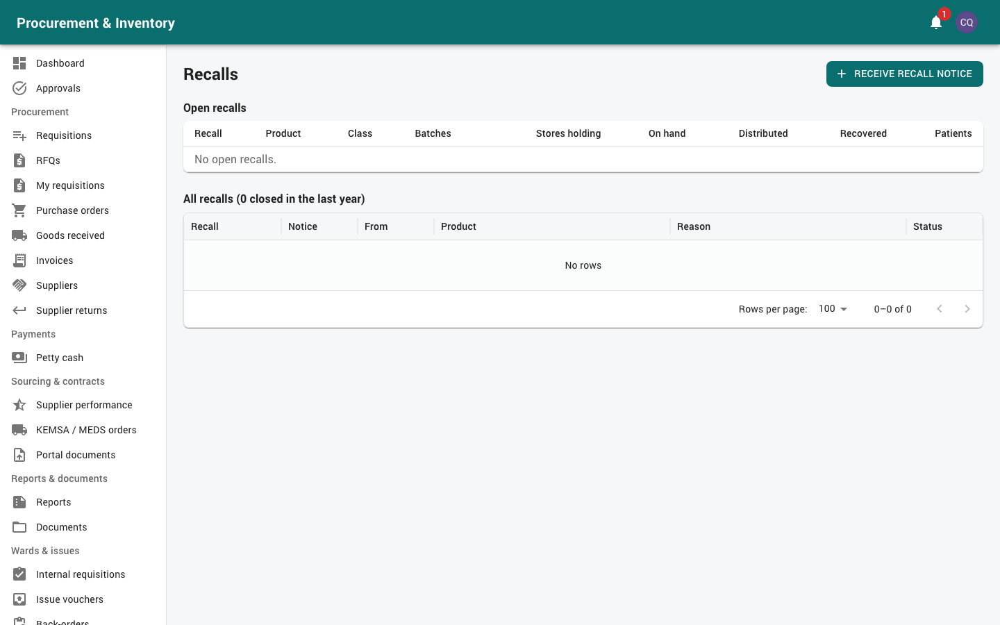

# Supply chain, quality and the tender committee

Three groups:
* the **Supply Chain Manager**: oversees procurement and stores, approves requisitions,
  disposals and tender awards, plans supply, manages contracts and the approval matrix;
* the **Quality / Cold-chain Officer**: quarantine and release, cold chain, complaints,
  recalls and disposals;
* **Tender / evaluation committee members**: score tenders and RFQs.

Read [Getting started](00-getting-started.md) first. The supply chain manager can also do
everything in [Procurement](02-procurement.md) and [Stores](03-stores.md).

---

## Part A: Supply chain manager

### 1. Approvals

*Approvals → My inbox*. By default:
* purchase requisitions 100,000 – 1,000,000 (after the procurement manager);
* disposals (all values, before finance);
* tender awards (before management);
* supplier suspension, blacklisting and reinstatement;
* stock adjustments and stock-take variances.

### 2. The approval matrix (*Approvals → Workflows*)

You maintain the approval rules for every document type: requisitions (REQ), purchase
requests (PR), orders (PO), invoices (INV), payment vouchers (PV), petty cash (PCV) and
replenishments (PCRP), internal requisitions (SR), plans, contracts, disposals, sanctions…

For each rule:
* **Document**, **amount band** (from / to, KES), optionally *Only for department*, *Only
  for item category*, *Only for currency*, and a **priority**. The most specific matching
  rule wins.
* **Steps**, in order:
  * the approver: a role (*Anyone with the role*), a *Role holder in the document's
    department* (e.g. the requester's head of department), or a named user;
  * *Approvals needed* (e.g. any 2 of the role);
  * *Remind after h* and *Escalate after h* / *Escalate to* (another role).

Editing a rule while documents are in approval keeps the old version for them; the change
applies to documents submitted afterwards. Test a change with a small document first.

### 3. Planning supply (*Planning*)

* **Demand forecasting**: forecasts per item and store (AMC, moving average or Holt-Winters,
  picked automatically by accuracy), with adjustment factors for outbreaks, new services
  or programmes. Selected suggestions become a draft PR (or a transfer for satellites).
  Accuracy (MAPE) is reported monthly.
* **Supply planning**: months of stock and pipeline per item against the minimum and maximum
  (2 / 4 months), and a month-by-month order schedule.
* **Quantification** per programme: morbidity method next to consumption method.
* **Donor stock**: stock by funding source, with restrictions (no sale, allowed stores and
  departments) that FEFO respects.

### 4. Contracts, suppliers and KPIs

* **Contracts** (*Sourcing & contracts → Contracts*): see [Procurement § 9](02-procurement.md).
* **Supplier performance**: monthly scorecards (on time, in full, quality, price compliance,
  documents). A score below 60 opens a **corrective action** to follow up.
* **Procurement KPIs**: lead times, plan execution, savings, spend by supplier / category /
  method, spend under contract, OTIF, forecast accuracy.
* **Organisation**: stores, bins, departments; numbering schemes; store **period locks**.
* **Background jobs** (*Administration → Background jobs*): check that the nightly stock,
  alert and reorder jobs ran; *run now* if needed.

---

## Part B: Quality / cold-chain officer

### 5. Holds (*Quality & safety → Quarantine & holds*)

Put a batch on hold for inspection, investigation, a complaint, a temperature excursion or a
recall. While **any** hold is open, the batch can't be issued, dispensed, sold or transferred
in **any** store (write-offs are still allowed).

To decide a hold (someone **other than** the person who placed it):
* *Release for use*, with a decision note; or
* *Reject (raise disposal)*: a draft disposal is created.

### 6. Cold chain (*Quality & safety → Cold chain*)

* **Units**: fridges, freezers and cold rooms per store (linked to bins), with ranges:
  fridge and cold room 2–8 °C, freezer −25 to −15 °C, ambient 15–25 °C.
* **Readings**: enter them by hand, or *Import logger CSV* (timestamp and temperature
  columns; local Nairobi time).
* An out-of-range reading opens an **excursion**, which (if your hospital turned it on)
  **quarantines** the unit's batches. Investigate, record the outcome, then release or reject
  the holds.
* A GRN arrival temperature outside the range also holds the received batches.

### 7. Complaints (*Quality & safety → Complaints*)

Anyone handling stock or patients can report. You investigate: product, batch, problem, type
(**Poor-quality medicine (PQM)** or **Adverse drug reaction (ADR)**), outcome / action taken,
optional quarantine of the batch. Record the PPB reference and the date sent, and print the
*Printable PPB report*.

### 8. Recalls (*Quality & safety → Recalls*)

1. *New*: notice source (PPB, supplier, manufacturer, internal), notice reference and date,
   the product and the batch numbers (or all batches), and instructions.
2. Every affected batch in **every store** is quarantined at once; pharmacy and stores staff
   are alerted.
3. The **trace** lists: on hand per store (quarantined), in transit, issued to wards,
   **dispensed and sold to patients (with phone numbers)**.
4. Returns from wards or patients: *Put into store (stays quarantined)*.
5. *Close recall*: **rejects** the holds (stock stays unusable until disposed of or returned
   to the supplier), or **releases** them if the recall was withdrawn.

### 9. Disposals (*Quality & safety → Disposals*)

For rejected, recalled, expired or obsolete stock:
1. Create the disposal (or it comes from a rejected hold): lines, **method** (destruction,
   sale, return to supplier, donation, transfer), **disposal committee** (at least 2 members
   sign off).
2. Approval: up to 100,000 → supply chain → finance; above that → + management.
3. On approval the stock is **written off**.
4. Record completion: place, agent / licensed handler / buyer, waste-transfer note, proceeds of
   a sale. The **disposal certificate** PDF is generated and stored.

### 10. GRN inspection

Quality officers can sit on the **inspection committee** for GRNs: *Record results* and
*Confirm as committee member* (see [Stores § 3](03-stores.md)).

---

## Part C: Tender and evaluation committee members

### 11. Tenders (*Sourcing & contracts → Tenders*)

1. You are named on the **evaluation committee** (one member is the chair).
2. Before scoring you must sign the **conflict-of-interest declaration**. If you declare a
   conflict, you can't score.
3. After the bid **opening**, evaluate in stages:
   * **preliminary**: pass / fail per bidder (decided by majority);
   * **technical**: score each weighted criterion (weights add up to 100); bidders below the
     pass mark drop out;
   * **financial**: calculated (lowest qualified price ÷ price × 100).
4. The **chair** records the committee's recommendation. At least 3 members must have scored.
5. Once the evaluation is **locked**, scores can't be changed.

### 12. RFQ evaluations (*Procurement → RFQs*)

When you are on an RFQ's committee: open the RFQ after bidding is closed → *Your technical
scores* → score every compliant quotation 0–100 with a comment. The procurement officer
completes the evaluation when all members have scored.

### 13. GRN inspection

Committee members may also be asked to inspect deliveries (*Procurement → Goods received →
Record results / Confirm as committee member*).
