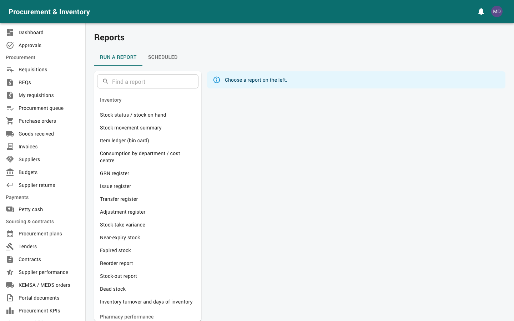

# Management and audit

For **Hospital Management** (medical director, CEO, administrators: top-level approvals and
oversight) and the **Auditor** (internal audit: read-only access to everything). Read
[Getting started](00-getting-started.md) first.

---

## Part A: Hospital management

### 1. Your approvals (*Approvals → My inbox*, or the email link)

By default, management approves the largest and most sensitive documents:

| Document | When |
|---|---|
| Purchase requisitions | ≥ 1,000,000 (after procurement and supply chain) |
| Purchase orders | ≥ 5,000,000 (after procurement and finance) |
| Supplier payment vouchers | > 1,000,000 (after the finance manager) |
| Petty cash requests | > 50,000 (after HOD, finance, finance manager) |
| Annual procurement plans | final step |
| Tender awards | after supply chain |
| Supplier suspension / blacklisting | after supply chain |
| Disposals | > 100,000 |

For each one, check:
* the **document chain** (requisition → quotations → order → delivery → invoice);
* the attachments;
* the **comparative sheet** and **award justification** for awards;
* the budget line;
* the earlier approvers' comments.

**Email approval**: the link in the approval email lets you approve, reject or return from
your phone without signing in. It works once, only for you, and expires after 72 hours.

**Away?** Delegate under *Approvals → Delegations* (dates, delegate, reason). Your delegate's
actions are recorded "on behalf of" you.

### 2. Dashboard

Tiles: approvals waiting for you, spend this month vs last month, open orders / LPOs (value),
invoices to pay, petty cash in hand, overdue advances, M-PESA payments failed or in review,
stock value and value expiring, write-offs, integration errors. Click a tile for the detail.
Six-month trends: stock value, write-offs, orders, sales.

### 3. Reports (*Reports*)

Useful for management, all with CSV / Excel / PDF export and *Email on a schedule* (e.g. a
monthly pack):
* **Purchases over time** (by department, supplier, category or GL, with previous-period
  change and a chart);
* budget vs committed vs actual vs paid;
* procurement cycle time, pending requisitions and purchase requests;
* AP ageing, payment schedule / cash requirement;
* petty cash spend;
* supplier performance and procurement KPIs;
* stock value, expiry losses and write-offs;
* pharmacy revenue and margin.

---

## Part B: Auditor

You can **see** everything (all stores and departments) and change nothing.

### 4. Audit log (*Administration → Audit log*)

Every create, change and delete, with **before / after values**, who, when, and from which
IP address. Secrets and bank details are redacted. The log can't be changed or deleted (the
database refuses).

Notable security events:

| Event | Meaning |
|---|---|
| `LOGIN`, `LOGIN_FAILED` (bad password, bad 2FA code, locked) | Sign-ins |
| `PAYMENT_RELEASE_BLOCKED` | Someone tried to release a payment without full approval, or as its preparer / approver |
| `PETTY_CASH_RELEASE_BLOCKED` | The same for petty cash |
| `PAYMENT_RESOLVED` | An M-PESA payment in review was resolved by hand |
| `MPESA_RESULT_CONFLICT` | M-PESA reported "paid" for an attempt recorded as failed |
| `TWO_FACTOR_ENABLED / DISABLED`, `PASSWORD_CHANGE` | Account security changes |

### 5. Audit reports (*Reports → Audit*)

* **Approval audit trail**: every approval action in a period with document, step, decision,
  who acted and **on behalf of whom** (delegations), channel (app or email link) and IP.
* **Payment control exceptions**:
  * **duplicate payments**: an invoice settled more than once, or the same petty cash payee
    and amount within the duplicate window;
  * **possible splits**: several requests by one requester (or orders to one supplier)
    within 3 days, each under an approval threshold and together over it;
  * **payments with nothing received or accepted** on the order lines invoiced.
* **QuickBooks sync status and errors**.

Also useful: three-way match exceptions, received-not-invoiced, M-PESA log and reconciliation,
WHT / VAT summary, petty cash book and cash-count variances, stock-take variances,
adjustments and write-offs registers, alerts overridden in the pharmacy, POS voids / refunds /
overrides.

### 6. Controls built into the system (what you can rely on)

* Nobody approves their own request; each approval step is by a different person; the
  payment preparer can't approve or release it.
* No payment (supplier or petty cash) can be released before **every** approval level.
* An M-PESA payment is never sent twice for the same voucher (enforced in the database).
* Non-stock purchases never change stock; every stock change is in an append-only ledger.
* Approval-email links are single use, personal and expire.
* Store-scoped users see only their stores.
* Every route needs a permission (checked by an automated test).

### 7. Documents (*Reports & documents → Documents*)

Search every attached file (delivery notes, invoices, licences, bids, certificates, evidence)
by name, record number, note or checksum. Earlier versions are kept, and files are checked
against their SHA-256 on download.
