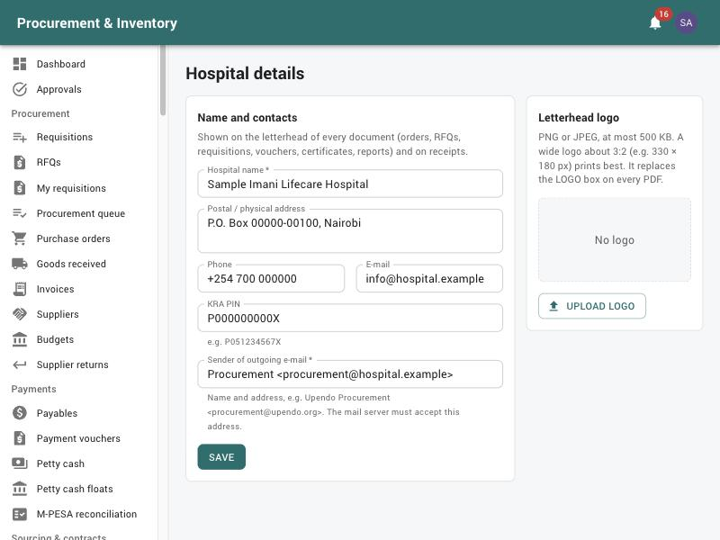

# System administrator

For the IT / system administrator who runs the application day to day: users and roles,
reference data, integrations and background jobs. Installation, TLS, environment variables,
backups and monitoring are in the technical **[Deployment guide](../DEPLOYMENT.md)**. Read
[Getting started](00-getting-started.md) first.

The System Admin role can see and do everything. Use it for administration only. For daily
work, give yourself the role you actually work in, and **turn on two-factor
authentication**.

---

## 1. The first administrator

A new production installation has no users. After the reference data is loaded, create the
first administrator from the server:

```bash
node dist/database/seeds/create-admin.js jdoe "Jane Doe" jdoe@hospital.org
```

The one-time password is printed once. Sign in, change it, and turn on 2FA (*My account*).
Then create the other users in the application.

## 2. Hospital details (*Organisation → Hospital details*)



The hospital's **name**, **address**, **phone**, **e-mail** and **KRA PIN** appear on the
letterhead of every document: orders, RFQs, requisitions, vouchers, certificates, reports
and receipts. Set them here before go-live.

* **Sender of outgoing e-mail**: the name and address approval e-mails, orders and reports
  come from, e.g. `Upendo Procurement <procurement@upendo.org>`. Your mail server must
  accept that address.
* **Letterhead logo**: *Upload logo* (PNG or JPEG, at most 500 KB; a wide logo about
  3:2, e.g. 330 × 180 px, prints best). It replaces the LOGO box on every PDF from then on.
  *Replace logo* and *Remove* change it.

Everyone with *org.read* can see the page; only administrators (*org.manage*) can change it.
Every change is recorded in the audit log (for the logo: its type, size and fingerprint).

## 3. Users (*Administration → Users*)

*New*: **username** (lower case), **full name**, email (for notifications and approval
emails), phone, **department** (it decides which department approvals the user receives as
in-charge, and their default cost centre), **roles**, **stores** (for store-scoped roles) and
an *Initial password*.

* The user must change the initial password at first sign-in.
* **Reset a password**: *New temporary password*. The user changes it at next sign-in.
* **Unlock**: accounts unlock by themselves after 15 minutes; resetting the password also
  helps.
* **Leavers**: untick **Active**. They are signed out at once and keep their history.
  Never delete or reuse accounts.
* **Store scope**: storekeepers, pharmacists and cashiers see only the stores you assign.
  Roles with *all stores* (procurement, finance, supply chain, audit, management) see
  every store.
* **Department in-charges** need the Department / Ward In-charge role **and** the right
  department. Approvals go to the in-charge of the requester's department.

## 4. Roles (*Administration → Roles*)

The built-in roles cover the usual jobs (see the [index](README.md)). You can create new roles
and tick permissions. Each permission's description says what it allows.

Guidelines:
* Keep segregation of duties. Don't give one person `payments.prepare`, approval of vouchers
  (through the Finance manager role) **and** `payments.release`. The system blocks the same
  person acting twice on one voucher, but a role design that relies on it is fragile.
* Give `inventory.handle_controlled` only to staff allowed to handle controlled drugs.
* Supplier users get only the **Supplier** role and must be linked to their supplier.

## 5. Organisation and catalog

* **Stores** and **Bins** (*Organisation*): main store, pharmacies, satellites; parent
  store (who supplies whom); quarantine, controlled-drug and fridge bins.
* **Departments** (*Organisation*): code, name and **cost centre**.
* **Items / Generics** (*Catalog*): code, generic, brand, base unit and pack conversions,
  category, tax category, batch tracking, controlled / cold-chain flags, GTIN / barcode,
  sales class (OTC / P / POM / CD), VED class.
* **Bulk import** (*Catalog → Bulk import*): CSV / Excel. Validate first, review errors and
  duplicates, then import.

## 6. Settings you may be asked to change

Business settings are in the database (ask the vendor or a developer where there is no
screen). Common ones, with their defaults:

| Setting | Default | Effect |
|---|---|---|
| `security.maxFailedLogins` / `security.lockoutMinutes` | 5 / 15 | Lockout after wrong passwords or 2FA codes |
| `approvals.linkExpiryHours` | 72 | Lifetime of approve-by-email links |
| `requisitions.requireGlAccount` | false | GL account required on requisition lines |
| `purchasing.rfqMinSuppliers` | 3 | Minimum suppliers on an RFQ |
| `purchasing.matchPriceTolerancePct` | 2 | 3-way match price tolerance |
| `purchasing.autoSendOnApproval` / `autoApproveMatchedInvoices` | false | Automation switches |
| `purchasing.lpoValidityDays` | 60 | Order validity |
| `purchasing.whtRates` | services 5 % | Withholding tax |
| `pettyCash.duplicateWindowDays` / `retirementDays` | 7 / 7 | Petty cash checks |
| `pos.discountLimits`, `pos.varianceTolerance` | 5 % cashier / 50 | Till rules |
| `accounting.autoSync` | false | Post to QuickBooks automatically |
| `jobs.schedules` | see below | Cron times of background jobs (applied when the worker restarts) |

Approval **workflows** are edited in the application (*Approvals → Workflows*). See
[Supply chain § 2](08-supply-chain-and-quality.md).

## 7. Background jobs (*Administration → Background jobs*)

Lists every job, its schedule, last run and result, with *run now*. Key jobs:

| Job | When | Why it matters |
|---|---|---|
| `payments.mpesaFollowUp` | every 5 min | Follows up M-PESA payments with no result |
| `approvals.escalate` | every 15 min | Reminders and escalations |
| `accounting.dispatch` / `autoSync` / `refresh` | 5 / 15 min / hourly | QuickBooks |
| `stock.expiry`, `stock.reorder`, `stock.amc`, `inventory.reconcile` | nightly / hourly | Stock alerts and checks |
| `purchasing.expireOrders` | 01:30 | Expires old LPOs |
| `pettyCash.retirementReminders` | 07:00 | Chases overdue advances |
| `reports.scheduled` | every 15 min | Emails scheduled reports |
| `etims.*`, `hmis.*` | every minute–daily | Integrations |

A failed job shows its error. Most are safe to *run now* again.

## 8. Integrations

* **KRA eTIMS** (*Pharmacy & billing → KRA eTIMS*): one control unit per selling outlet
  (initialise it), code-table sync, **mappings** (items without a mapping can't be invoiced),
  the **outbox** (status, attempts, the call log, reprocess failed), and the
  *Specification notes*.
* **HMIS** (*Pharmacy & billing → HMIS integration*): connection (FHIR, REST, HL7 v2 or mock),
  *Test connection*, who bills (here or the HMIS), **code mappings** (drug codes, locations,
  wards, payers). The **dashboard** shows failed messages and **unmapped drug codes**: map
  them, then reprocess.
* **QuickBooks**: see [Finance § 5](06-finance.md).
* **M-PESA**:
  * till payments (STK / C2B): *Point of sale → POS setup → M-Pesa*;
  * supplier and petty cash **payouts**: configured on the server only (see the
    deployment guide). Credentials are never entered in the application.
* **API clients** (for the HMIS pushing invoices or orders): created through the API
  (`/api/v1/api-clients`, administrator only; there is no screen yet) with their scopes.
  The key is shown **once** and stored hashed.

## 9. Monitoring and support

* **Dashboard** integration tiles (eTIMS, HMIS, QuickBooks errors).
* **Audit log** (*Administration → Audit log*): who changed what and when.
* `ops/monitoring/check.sh` on the server (API, worker, jobs, mail queue, M-PESA, QuickBooks,
  eTIMS / HMIS, backup age). See the deployment guide.
* **Mail not arriving?** The outbox retries; check the SMTP settings with IT. Users can also
  have switched email off in *My account → Notification preferences*.

Common support requests:

| Request | Answer |
|---|---|
| "I can't see menu X" | Add the role that has the permission; store-scoped roles also need the store |
| "I'm not getting approvals" | Check the user's role **and department** (in-charge approvals follow the requester's department), and their notification preferences |
| "Approval went to the wrong person" | Check *Approvals → Workflows*: band, department, category, priority |
| "Locked out" | Wait 15 minutes, or give a new temporary password |
| "Lost my phone (2FA)" | An administrator can't read the secret. Give a new temporary password; if 2FA must be removed, a developer clears it, and the user then sets it up again |
| "eTIMS PENDING on receipts" | Check the eTIMS outbox and control unit; documents are re-sent automatically |

## 10. Backups

Nightly backups and a weekly restore drill are run by IT with `ops/backup/`. See the
[Deployment guide § 8](../DEPLOYMENT.md). Keep the encryption keys and the backup
passphrase in the secret store, not with the backups.
